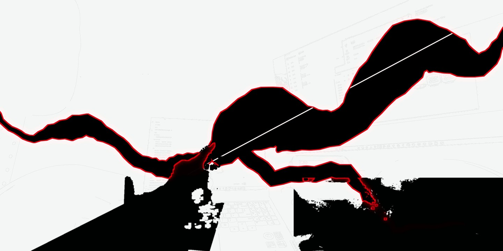
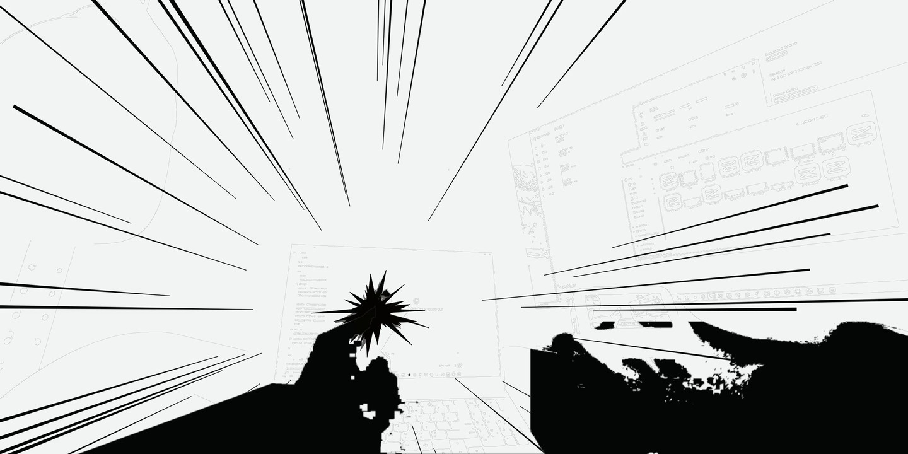
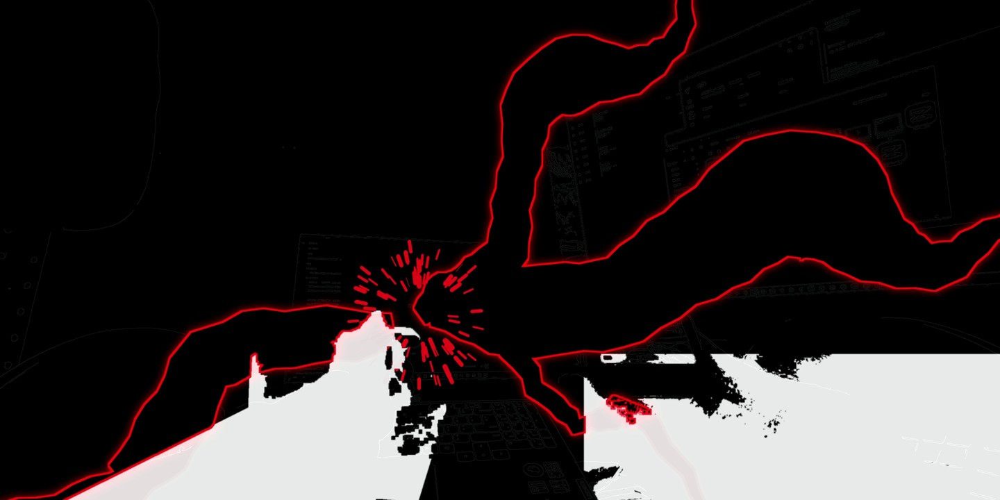
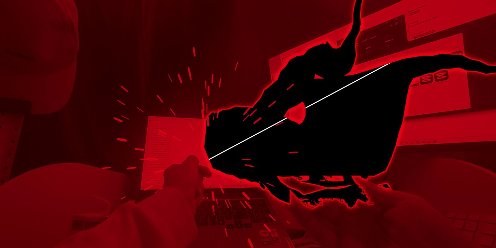

<h1 align="center">BLACK FLASH</h1>
<p align="center"><strong>实拍动作 · 动漫冲击 · 原声驱动</strong></p>
<p align="center">面向 Codex 的黑闪冲击帧制作技能<br>从真实接触到果断爆发，让画面、声音和音乐落在同一个瞬间。</p>
<p align="center"><code>Codex Skill</code> · <code>Python 3.10+</code> · <code>MIT</code></p>
<p align="center"><a href="#quick-start">快速开始</a> · <a href="#gallery">效果展示</a> · <a href="#toolchain">工具与依赖</a> · <a href="https://github.com/81823650800wzy-sketch/black-flash-impact-skill/releases">下载安装包</a></p>


<p align="center"><sub>实际编码成片截图 · 接触曝光 / 换形闪电 / 源场景合成</sub></p>

**black-flash-impact** 将响指、拳脚、碰撞或物体接触制作成有蓄力、有释放、有环境后果的动漫冲击帧。工作流覆盖原声增强、音乐卡点、连续变速、动态遮挡、粒子与空间波动，最终交付带声音预览和可编辑工程。

Standalone Codex skill for anime-style impact frames in live-action footage, with source-derived audio, music sync, continuous retiming and scene interaction.

> **它是一套可执行的制作方法与辅助工具。** 两个 Python 助手负责时间规划和原声派生分轨；实际追踪、绘制、合成与渲染由使用技能的 agent 按素材选择工具完成。无需安装另一套个人技能。

<a id="gallery"></a>
## 效果展示

| 黑白冲量 | 负片换稿 | 红色释放 |
|:---:|:---:|:---:|
|  |  |  |
| 简化背景，明确接触中心 | 改变曝光与主轮廓，保持力度 | 回到源场景，以余势结束爆发 |

精选实际成片帧，统一裁切为 2:1 并压缩展示；未额外重画效果。[图片来源与使用说明](docs/images/NOTICE.md)。静帧展示视觉形态，动态与音效另需连续视听检查。

## 制作重点

| 环节 | 关键做法 | 避免的问题 |
|---|---|---|
| **动作落点** | 标记预备、释放、接触、余势；以真实接触对应音乐重音 | 只让切镜在拍上，动作却迟到 |
| **原声与重量** | 保留每个动作的干声，分配主体、sub、攻击与尾部 | 所有物体变成同一个爆炸声；加低频反而压弱响指 |
| **连续变速** | 单调源时间映射、接触锁定和关键曝光保护 | 接触前跳镜、重新蓄力、漏掉主稿 |
| **动漫形态** | 快速换形缠绕，接触帧直接给完整主形 | 同一折线重复旋转；主爆发缓慢开花 |
| **场景交互** | 接触点发射、前后遮挡、局部源像素形变与传播衰减 | 粒子浮在手上；光圈冒充空间波动 |
| **画质与交付** | 原片 RGB、目标尺寸重绘、最终编码与迁移验证 | 低清预览反复编码；只交付不可重建的成片 |

<a id="quick-start"></a>
## 快速开始

### 1 · 安装技能

**下载 ZIP：** 从 [Releases](https://github.com/81823650800wzy-sketch/black-flash-impact-skill/releases) 下载 `black-flash-impact-v1.0.1.zip`，解压后将 `black-flash-impact` 文件夹放入 Codex 的 skills 目录；在新会话刷新技能列表。

**或使用 Git：** Windows PowerShell：

```powershell
$impactSkillPath = Join-Path $env:USERPROFILE '.agents/skills/black-flash-impact'
git clone https://github.com/81823650800wzy-sketch/black-flash-impact-skill.git $impactSkillPath
```

已有同名目录先检查本地修改，避免覆盖。当前官方个人技能目录为 `~/.agents/skills`，macOS / Linux 可安装到 `~/.agents/skills/black-flash-impact`。若客户端指定其他技能目录，以实际配置为准，避免两处重复安装。安装后未出现时重启客户端。见 [OpenAI 官方技能说明](https://learn.chatgpt.com/docs/build-skills)。

### 2 · 准备输入

提供原始高质量动作视频；需要卡点时提供有使用权的音乐，说明主爆点或允许 agent 分析。补充要保留的配音/字幕、片长、循环与预览方式。已有对话选择可直接沿用，未提供音乐也能制作单个动作冲击。

### 3 · 发起制作

```text
使用 $black-flash-impact，把这些实拍接触动作制作成黑闪。
保留每个原动作声音的辨识，补强低频、主体和攻击。
根据提供的音乐定位主爆点，连续动作采用变速卡点。
电弧、粒子要有动态遮挡和环境反馈。
保留指定配音与字幕，输出完整预览和可编辑工程。
```

<a id="toolchain"></a>
## 工具与依赖

**安装技能**只需要下载或 Git。**运行配套助手**需要 Python 依赖；**制作实际视频**还需要媒体处理和合成能力。没有绑定唯一剪辑软件。

| 工具 | 何时需要 | 负责什么 | 是否包含 |
|---|---|---|---|
| **Codex + 本技能** | 使用技能制作时 | 读取素材与要求、选择方法、执行并检查交付 | 技能文件包含；Codex 自行安装 |
| **[Python](https://www.python.org/downloads/) 3.10+** | 运行两个助手时 | 时间排程、原声分轨与测试 | 自行安装 |
| **NumPy / SciPy / SoundFile** | 运行助手时 | 数组、PCHIP/滤波/重采样、WAV 读写 | 通过 `requirements.txt` 安装 |
| **[FFmpeg / FFprobe](https://ffmpeg.org/download.html)** | 实际媒体处理与交付时 | 取帧、探测、抽音轨、封装、编码和全解码检查 | 自行安装，并加入 PATH |
| **二维合成工具** | 绘制/合成实际冲击帧时 | 动态 alpha、手绘曝光、色散、环境变形 | 可选 Python + OpenCV/Pillow，或已有剪辑合成软件 |
| **[Blender](https://www.blender.org/download/)** | 需要有厚度碎片、碰撞、体积交互或三维空间时 | 追踪、遮挡体、粒子/几何、缓存与透明渲染 | 可选，不是两个助手的依赖 |
| **音频工作站/编辑器** | 复杂降噪、混音或听审时 | 清理、分轨自动化、监听与母带调整 | 可选，使用已有工具即可，如 [Audacity](https://www.audacityteam.org/download/) |
| **人声分离工具/模型** | 说明配音与背景音乐重叠、需要分离时 | 分离后修补并检查伪影 | 可选，需另行安装与授权；不含权重 |

<details>
<summary><strong>安装与检查 Python / FFmpeg 环境</strong></summary>

在技能目录执行。代码最低 Python 3.10，本项目已在 3.12 验证；新安装选择官方仍支持、且依赖库已提供安装包的版本。可先创建并激活虚拟环境；Windows 某些环境使用 `py` 代替 `python`。

```shell
python --version
python -m pip install -r requirements.txt
python -c "import numpy, scipy, soundfile; print('Audio/timing tools ready')"
ffmpeg -version
ffprobe -version
```

运行 Python 助手无需 Blender 或 FFmpeg。若采用 Python 进行视频合成，可额外安装：

```shell
python -m pip install opencv-python pillow
```

完整视频制作需要当前执行环境拥有本地文件与相关工具权限。技能包不含原素材、音乐、商业软件、字体或分离模型；安装工具也不代表取得媒体的使用权。

</details>

## 配套助手

| 命令 | 输入 → 输出 | 边界 |
|---|---|---|
| [`plan_timing.py`](scripts/plan_timing.py) | 原曲事件、源接触和保护窗口 → cue、逐帧源时间映射、速度与量化误差 | 不自动识别节奏；按 CFR 规划，VFR 先核 PTS |
| [`enhance_contact.py`](scripts/enhance_contact.py) | 单个动作录音及起音 → 干声、主体、sub、主处理差分、混音与报告 | 不自动降噪；不是通用爆炸生成器或完整母带器 |
| [`test_tools.py`](scripts/test_tools.py) | 临时匿名测试信号 → 七项行为测试结果 | 不作音色示范或主观听审 |

```shell
python scripts/plan_timing.py examples/timing.json --out timing-result.json
python scripts/enhance_contact.py contact.wav --onset 0.10 --out enhanced
python scripts/test_tools.py
```

`contact.wav` 替换为自己的动作录音；`--onset` 是该文件中的真实起音秒。混音时按报告扣除预卷，不把裁切窗口开头误放在鼓点上。时间输入格式见 [示例](examples/timing.json) 与 [节奏参考](references/timing.md)，声音分层用法见 [声音参考](references/audio.md)。

## 工作流与交付

**定位接触 → 分析音乐 → 净剪与变速 → 原声增强 → 动画与场景交互 → 编码后视听检查 → 可移植工程**

从代表难点的连续短段开始，完成全部要求后输出带声音预览。工程保留 cue、源时间、追踪、动态 alpha、手绘形态、粒子缓存和音频分轨；实际解压到新目录重建，才称可移植。

| 深入阅读 | 内容 |
|---|---|
| [技能入口](SKILL.md) | 完整执行顺序、触发范围与工具分工 |
| [音乐与变速](references/timing.md) | 静音前导、绝对时间、拍内密度和曝光保护 |
| [声音设计](references/audio.md) | 原声辨识、低频重量、配乐让位、起音与峰值 |
| [视觉制作](references/visuals.md) | 换形电弧、粒子遮挡、环境波动和原片画质 |
| [交付检查](references/delivery.md) | 最终编码、收尾、分轨和迁移验证 |
| [验证记录](VALIDATION.md) | 七项行为测试及证据范围 |

## 许可与来源

代码、技能文档和助手采用 [MIT 许可](LICENSE)。本页四张效果截图为经授权展示的成片画面，单独按 [图片使用说明](docs/images/NOTICE.md) 管理，不纳入 MIT 的媒体授权。没有分发原视频、配乐、动画原作音效、生产工程、字体或模型权重。

技术测试不能替代最终视听检查，也不代表用户已认可某一版观感或听感。请为自己使用的素材保留来源与许可记录。
